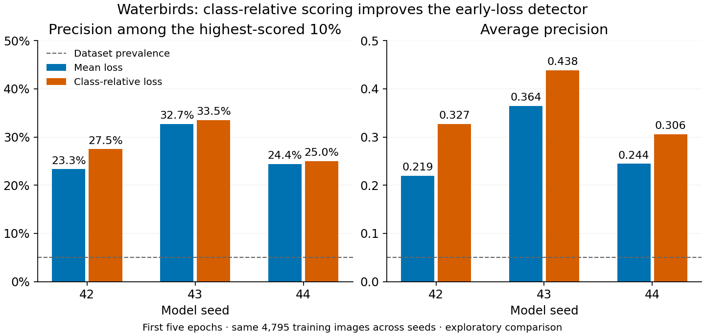

# Waterbirds Training Dynamics

A bird classifier can get the right answer for the wrong reason. In Waterbirds, landbirds usually appear on land and waterbirds usually appear on water. I wanted to see whether a model's behaviour during training could help find images where that shortcut stops working.

I trained an ImageNet-pretrained ResNet-18 and recorded each image's loss, confidence and prediction after every epoch. The images keep the same IDs when training is shuffled, so I can follow the same example over time. I ran the experiments on Sheffield's Stanage cluster using Slurm and an A100 GPU, with 30 epochs and three random seeds.

Normal training reached **87.50% overall test accuracy**, but only **43.98% on the weakest bird/background group**, averaged over the three seeds. The overall number hid a much bigger problem on the less common combinations.

I first ranked training images by their mean loss over the first five epochs. Only about 5% of training images have conflicting bird/background combinations, but they made up **26.81% of the highest-loss 10%** on average. The loss was finding something useful.

Looking at the selections, I found that waterbirds took up 39–65% of that list even though they were only about 23% of the training set. So I changed the score to compare an image's loss with other images of the same bird type. This uses the bird labels already available during training; background labels are only used afterwards to check the ranking.

That change improved top-10% precision from **26.81% to 28.68%**, or **1.88 percentage points**. Average precision rose from **0.276 to 0.357**, about **29% relative**. Both measures improved in all three seeds, using the saved training histories without another GPU run.

I also tested whether prioritising difficult images actually helped train a better classifier. I compared normal training, JTT-style retraining on early mistakes, early-loss selection, and a random-selection control. The original early-loss version reached **47.40% mean worst-group accuracy**, but random selection reached **48.60%**. It did not demonstrate an advantage over that control.

The class-relative detector was a follow-up to that experiment. I have measured its better ranking, but have not yet tested whether using it for retraining improves the classifier. The follow-up is exploratory, and the three model seeds use the same images rather than new held-out datasets. It changes how the two bird classes are ranked against each other; the ordering within each class stays the same.

The pipeline has epoch-level checkpoints, saved optimiser and random states, and 23 automated tests covering selection rules, sample IDs, subgroup metrics and incomplete results. A deliberately interrupted synthetic run reproduced the uninterrupted models and predictions. Slurm runs one seed at a time, with validation-based checkpoint selection and separate test evaluation.

The [results and limitations](docs/RESULTS.md) link to the raw CSVs, source snapshots and per-seed comparisons. The [detector notes](docs/DETECTION.md) explain the scoring change, and the [running guide](docs/RUNNING.md) has reproduction commands. The [original notebook](01_baseline_waterbirds.ipynb) keeps the earlier Colab exploration.

[Waterbirds through WILDS](https://github.com/p-lambda/wilds/blob/main/wilds/datasets/waterbirds_dataset.py) · [Just Train Twice](https://github.com/anniesch/jtt)
